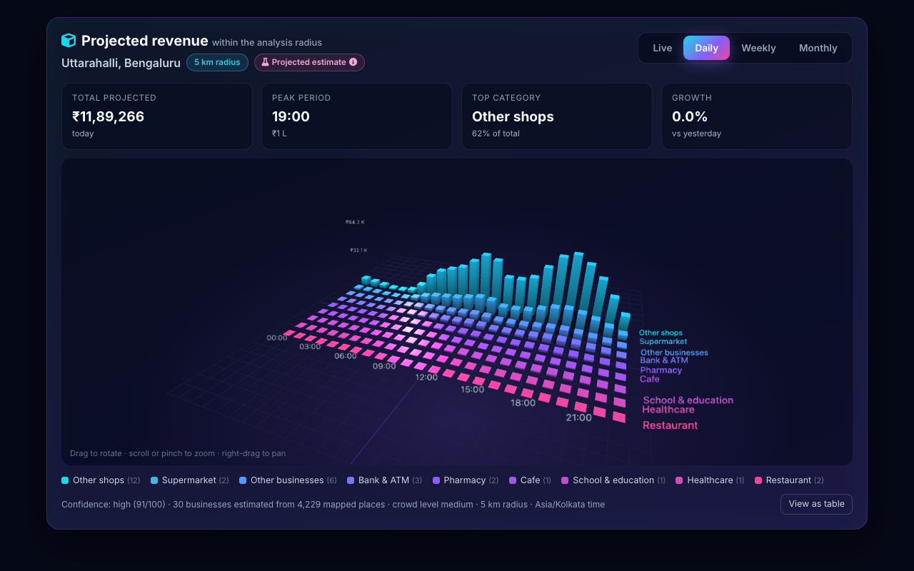
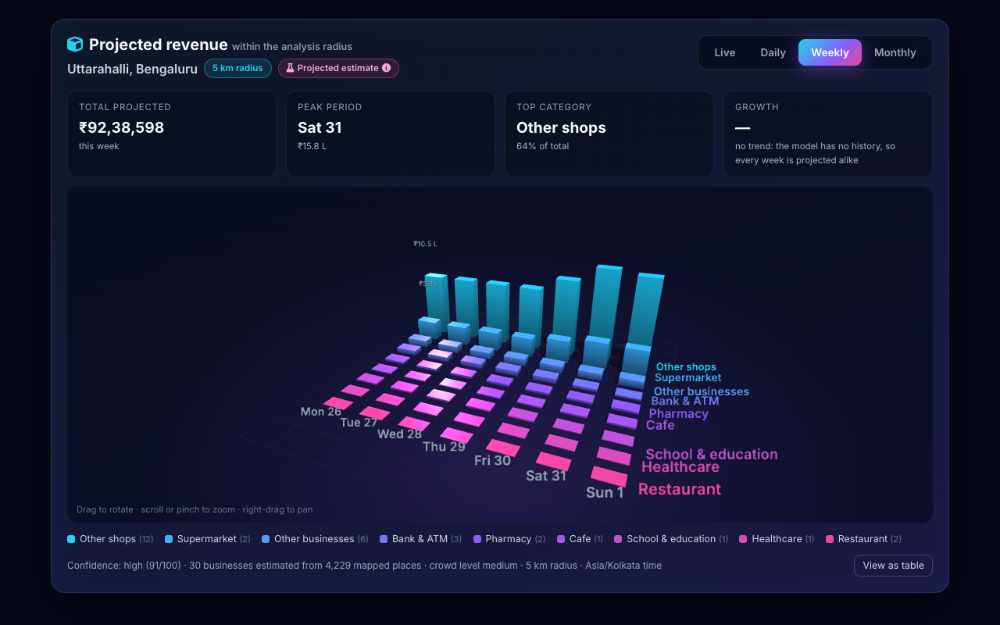
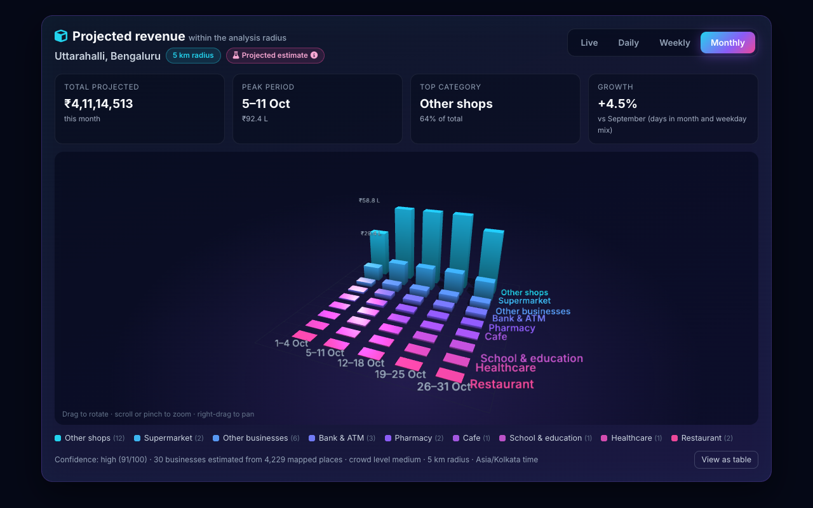
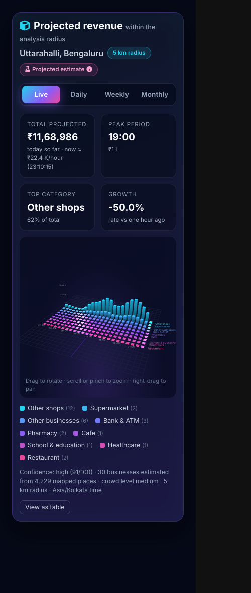
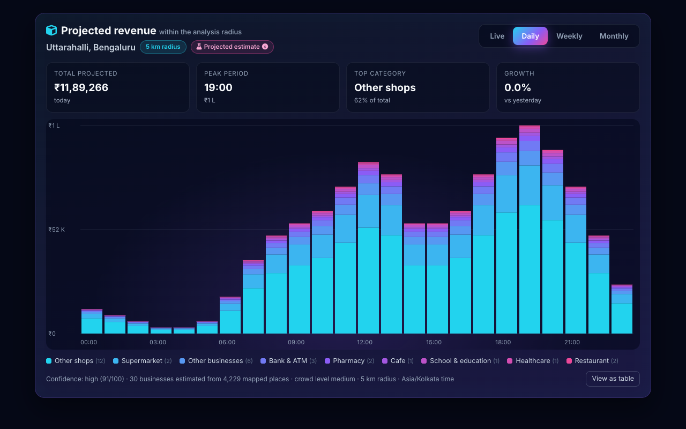

<div align="center">

# 🗺️ Crowd Heatmap & Business Intelligence Platform

**Pick any place in India and see what the 5 km around it can support.**

Live crowd heatmaps · business recommendations · 3D revenue projections · designed PDF reports

[](https://www.python.org/)
[](https://www.djangoproject.com/)
[](https://channels.readthedocs.io/)
[](https://supabase.com/)
[](https://www.openstreetmap.org/)
[](#-testing)
[](#-license)

[🚀 Getting started](#-getting-started) ·
[✨ Features](#-features) ·
[🧭 User guide](#-user-guide) ·
[🔌 API](#-api-reference) ·
[🩺 Troubleshooting](#-troubleshooting)



</div>

---

## 📖 Overview

A location-intelligence web app built on **live OpenStreetMap data**. Choose a spot on the map and
the platform analyses the **5 km circle** around it, then tells you which businesses fit there,
what they could earn and why.

| | Feature | What you get |
|---|---|---|
| 🔥 | **Crowd heatmap** | 9 sectors coloured by how densely the area is mapped |
| 📍 | **Popular places** | Up to 30 nearby businesses with revenue, health and potential scores |
| ✅ | **Feasibility** | A Go / No-Go verdict for a business type, with the reasons |
| 🏆 | **Top 5 businesses** | The best businesses to open there, with profit and break-even |
| 🤝 | **Synergy score** | How much the surroundings could help a business (0–100) |
| 📊 | **3D revenue graph** | Live, daily, weekly and monthly projections |
| ❤️ | **Favorites** | Saved places, personal picks and a side-by-side comparison |
| 📄 | **PDF reports** | A designed ~30-page location dossier, or a favorites comparison |
| 💬 | **AI assistant** | A chatbot that answers questions and opens features for you |
| 🧭 | **Guided tour** | An 8-step spotlight walkthrough for new users |

> [!NOTE]
> All revenue figures are **model projections** from mapped places and the platform's Extended Huff
> revenue engine. They are not measured sales, and the app labels them that way.

---

## 📑 Contents

- [📖 Overview](#-overview)
- [✨ Features](#-features)
- [🧭 User guide](#-user-guide)
- [🖥️ Pages](#️-pages)
- [⚙️ How it works](#️-how-it-works)
- [🧰 Tech stack](#-tech-stack)
- [📁 Project structure](#-project-structure)
- [🚀 Getting started](#-getting-started)
- [🔧 Configuration](#-configuration)
- [🔐 Supabase](#-supabase)
- [🛡️ Security](#️-security)
- [🧪 Testing](#-testing)
- [🔌 API reference](#-api-reference)
- [🧠 Data and models](#-data-and-models)
- [☁️ Deployment](#️-deployment)
- [🩺 Troubleshooting](#-troubleshooting)
- [⚠️ Limitations](#️-limitations)
- [📚 Further documentation](#-further-documentation)
- [🤝 Contributing](#-contributing)
- [📜 License](#-license)

---

## ✨ Features

### 🔥 Live crowd heatmap

- Search a place, click the map, use **Find My Location**, or open a saved favorite. The map flies
  to the pin and draws the **5 km analysis circle**.
- The circle is split into **9 sectors** (3 rings × 3 compass wedges), each coloured by its density
  of mapped places:

  | Colour | Level | Mapped places per km² |
  |:---:|---|---|
  | 🔴 | High | 60 or more |
  | 🟡 | Medium | 25–59 |
  | 🟢 | Low | below 25 |

- The footer shows how many places are mapped in the circle and an estimated monthly revenue for
  the listed businesses.
- **Popular Locations** shows up to 30 named businesses spread across the circle, as map pins and
  as cards with revenue, health and potential scores.

### 📊 Business Analytics: 3D revenue graph

- Open it from **Business Analytics** in the sidebar, the **AI Recommender** button or the
  **Revenue Intelligence** card. It shows the area you analysed last.
- An interactive 3D bar chart: time × business category, with projected ₹ revenue as the height.
- **Live, Daily, Weekly and Monthly** views. Live updates every 5 seconds over a WebSocket, with
  polling as a fallback.
- KPI cards for total, peak period, top category and growth, plus confidence and assumptions.
- Works on phones (touch to rotate and zoom). Without WebGL it falls back to a 2D chart, and a
  table view is always available.

<details>
<summary>🖼️ More screenshots</summary>

| Weekly | Monthly |
|---|---|
|  |  |

| Mobile | 2D fallback (no WebGL) |
|---|---|
|  |  |

</details>

### 🏆 Business recommendations

- The **Top 5 businesses** to open in the selected area. Candidates come from the ML model and from
  every category the revenue engine models.
- Each candidate is placed in the sector that suits it best and costed with the revenue engine.
- Cards show estimated revenue, profit, break-even, crowd level and competition within 1 km.
- Pick the location (current area, recent searches or favorites) and filter by category.
  **View on Live Map** jumps to the spot.

### 🤝 Business Synergy Intelligence

- A **Synergy Potential Score (0–100)** for a business at a site, worked out by fixed rules from
  real OpenStreetMap places within 1.5 km. No AI invents the numbers.

  | Factor | Weight |
  |---|---:|
  | 🧩 Complementary businesses | 30% |
  | 🚉 Surrounding demand (transit, campuses, homes, tourism) | 25% |
  | 👥 Matching customer groups | 20% |
  | ⚔️ Competition-adjusted opportunity | 15% |
  | 🚶 Accessibility | 10% |

- **Revenue scenarios** on top of the engine's base estimate:
  `uplift = cap × score/100 × (0.5 + 0.5 × data coverage)`, with illustrative caps of
  5 / 10 / 15% (conservative / moderate / optimistic).
- A plain-language explanation: why the site fits, which named places help, the opportunity in ₹,
  the risks and next steps.
- Shown on every Top 5 card, in a best-by-model / synergy / overall comparison
  (overall = 0.6 × model + 0.4 × synergy), in the **Synergy Revenue Intelligence** panel and in the
  PDF report.
- Tune it with the Django settings `SYNERGY_WEIGHTS` and `SYNERGY_UPLIFT_CAPS`
  (code: `business_intelligence/synergy/`).

### 🚀 Startup form and feasibility

- Enter a business type, a location and the crowd level you want. The inquiry is saved and the
  Go / No-Go rules run, with reasons.
- You land on the map, centred on the location, with the matching sectors highlighted.
  **Generate Detailed Report** then writes a report on that location and business.

### 📄 PDF reports

| Report | Contents |
|---|---|
| 📍 **Single location** (~30 pages) | Cover, contents, executive summary with KPIs, location overview, the live heatmap screenshot, sector analysis, recommendations, competition, revenue forecast, synergy analysis, feasibility, roadmap, risk matrix, checklist and appendix |
| ❤️ **Favorites comparison** | For each saved place (up to 6): crowd and heatmap, popular places, revenue, competitors, Go / No-Go, SWOT and key risks, plus a ranked comparison table |

- **Business category:** the one you chose. Otherwise, the **top pick of the location ranking**
  (crowd level, competition within 1 km and revenue potential at that spot).
- **Explanations:** written by Google Gemini when `GEMINI_API_KEY` is set and fact-checked against
  the data. Otherwise built from each location's own data: area profile, busiest sectors, the
  nearest named competitor, customer mix and business-specific next steps.
- **Progress:** reports run in the background. The button shows each stage live, and the finished
  PDF downloads by itself.
- **Rendering:** WeasyPrint for the full design, with a shorter ReportLab fallback when Pango is
  missing.
- **Storage:** reports are kept per user for 24 hours under **Favorites → Generated Business
  Reports**.

### ❤️ Favorites

- Save any place with the heart icon: the map's **save this location** control, Popular Places
  cards or Top 5 cards. Stored in Supabase with row-level security, so each user sees only their
  own.
- A spot is keyed by its coordinates (~11 m), so it is never saved twice under different names.
- The **Favorites page** shows each place's saved date, coordinates and analysis status, and for
  analysed areas the top opportunity with projected revenue and synergy score.
- **Open location** jumps to the map and runs the analysis, reusing fresh cached data.
- Search, filter by category, remove, or tick places for the comparison PDF (with nothing ticked,
  the 6 most recent are compared).
- **Recommended for you** ranks places by community saves, your own saves and distance.

### 🧭 Guided tour

- New users get a welcome prompt offering a one-minute tour, or they can skip it. The choice is
  remembered in the browser.
- **8 steps**, each spotlighting its part of the app with the page still visible behind: overview,
  sidebar, heatmap and search, 3D analytics, Top 5 recommendations, feasibility, AI assistant and
  PDF reports, and launch.
- Step counter, clickable progress dots, Back / Next, and keyboard shortcuts (`→`, `←`, `Esc`).
- Restart it any time from **Guide** in the navbar, **Guided Tour** in the sidebar, or **Tour** in
  the dashboard header.

### 💬 AI assistant

- A floating chatbot that answers questions about the platform, opens features ("show business
  analytics", "take me to the map") and answers feasibility questions such as
  *"Is a pharmacy feasible in Koramangala?"*.
- Optional Gemini analysis, with a Grok risk review when both API keys are set.

### 👤 Accounts

- Sign-up with e-mail confirmation (and resend), sign-in, password reset, sign-out and automatic
  session refresh, all through Supabase.
- 👁️ Every password box has a **show / hide** eye button.
- A profile page for name, avatar and password.
- The session is checked with Supabase before the UI shows you as signed in. After signing in you
  return to the feature you asked for.

### 🎨 Look and feel

- Signed-in pages follow the design system in [`designs/DESIGN.md`](designs/DESIGN.md)
  (`static/css/theme-mono.css`): white background, black text and hairlines, uppercase serif
  headlines and monospace labels.
- The heatmap keeps its red / amber / green colours, and the 3D graph and popular-place cards stay
  dark. The sign-in page has its own look with a Three.js globe.

---

## 🧭 User guide

A typical first session, start to finish:

| Step | Do this | You get |
|:---:|---|---|
| 1️⃣ | **Sign up** at `/login/` and confirm the e-mail link | An account; the guided tour starts on your first visit |
| 2️⃣ | **Search** a place (or click the map, or use 📍 Find My Location) | The map flies there and draws the 5 km circle |
| 3️⃣ | Wait for the **heatmap** (instant if the area is cached) | 9 coloured sectors and a place count |
| 4️⃣ | Click **Popular Locations** | Up to 30 businesses as pins and cards |
| 5️⃣ | Open **Business Analytics** | The 3D revenue graph for that area |
| 6️⃣ | Open **Business Recommendations** | The Top 5 businesses with synergy scores |
| 7️⃣ | Tap ❤️ on places you like | They appear on the **Favorites** page |
| 8️⃣ | Click **Generate Detailed Report** | A ~30-page PDF for that location |
| 9️⃣ | On **Favorites**, tick places → **Download Report** | A comparison PDF of your saved places |

> [!TIP]
> The first analysis of a brand-new area waits on public OpenStreetMap servers (often 25–45 s).
> Places viewed in the last 10 minutes are cached and answer almost instantly, which also makes
> favorites reports much faster.

---

## 🖥️ Pages

| URL | Page | Sign-in |
|---|---|:---:|
| `/` | 🏠 Home: overview and contact | – |
| `/dashboard/` | 🗺️ Dashboard: map, heatmap, analytics, recommendations, startup form | ✔️ for saving and reports |
| `/business-recommendations/` | 🏆 Shortcut: opens the dashboard on the AI recommendations | – |
| `/favorites/` | ❤️ Saved places, picks and generated reports | ✔️ |
| `/profile/` | 👤 Name, avatar and password | ✔️ |
| `/login/` | 🔑 Sign in, create account, reset password | – |
| `/auth/callback/` | ✉️ Landing page for Supabase e-mail links | – |
| `/contact/` | 📨 Contact form | – |
| `/admin/` | 🛠️ Django admin | Django superuser |

---

## ⚙️ How it works

```text
Browser (Leaflet map, dashboard, Three.js graph, chatbot)
  │  Supabase JS – sign-in; session checked with the auth server before the UI trusts it
  │
  ├─ HTTP ─► Django views
  │           ├─ fetch_area_pois()        one Overpass query per area (5 km), hedged across mirrors,
  │           │                           cached on disk (fresh 10 min, kept 7 days), never fake data
  │           ├─ compute_area_analysis()  sectors · popular places · ML prediction (cached)
  │           ├─ revenue engine           Extended Huff, 1.5 km catchment per site
  │           ├─ revenue_timeseries       live / daily / weekly / monthly projection
  │           └─ report_generator         background PDF jobs (WeasyPrint → ReportLab)
  │
  ├─ WebSocket ─► ws/chat/       AI assistant
  │              ws/analytics/  live revenue pushes every 5 s
  │
  └─ Supabase
       ├─ Auth: sign-up / sign-in / reset / sessions; the server verifies tokens for
       │         reports, analytics and ws/analytics/
       └─ Postgres (RLS, user's own token): favorite_places · community_favorites() ·
                 profiles · user_history (+ views) · user_activity_logs
```

- 🎯 **One selected area.** Search, pin, GPS, favorite, recommendation and startup form all set the
  same "selected area". The heatmap, popular places, reports and analytics all read it, and late
  answers for an older place are thrown away.
- ⏱️ **One fetch per place.** When Overpass is slow, requests answer "still fetching" within 18 s
  while the fetch carries on in the background, and the page retries. Cached areas answer in well
  under a second.

### 📄 Report pipeline

```text
POST /api/reports/generate/  or  /api/favorites/report/
  └─► admission (1 running report per user, 10 per hour, 2 at once)
        └─► background thread
              collect data ─► crowd ─► recommend ─► revenue ─► text (Gemini or template)
              ─► charts & flowcharts ─► PDF (WeasyPrint / ReportLab) ─► validate ─► ready
  browser polls /api/reports/<id>/status/ every 2 s, then downloads /api/reports/<id>/download/
```

A favorites report runs the lighter per-place analysis it actually prints, and downloads the next
places' map data (two at a time) while the current one is analysed.

---

## 🧰 Tech stack

| Layer | Technology |
|---|---|
| 🐍 Backend | Django 5.2 / 6.0, Django Channels + Daphne (ASGI, WebSockets) |
| 🖥️ Frontend | HTML, CSS, vanilla JavaScript, Bootstrap 5, Leaflet, Three.js r128 |
| 🗺️ Map data | OpenStreetMap: Nominatim (geocoding), Overpass API (places) |
| 🧠 Models | Scikit-Learn decision tree (business type), Extended Huff gravity revenue engine |
| 🤖 AI (optional) | Google Gemini (assistant and report text), xAI Grok (risk review) |
| 🔐 Supabase | Auth, plus Postgres with row-level security for profiles, favorites, history and activity logs |
| 🗄️ Django database | SQLite (startup inquiries, contact messages, generated PDF reports) |
| 📄 PDF | WeasyPrint (needs Pango), ReportLab fallback, Matplotlib charts |
| 📦 Static files | WhiteNoise |
| 🧪 Tests | Django test runner, Node's built-in test runner with jsdom |

---

## 📁 Project structure

```text
├── crowd_heatmap_project/     ⚙️ settings, URLs, ASGI; ML training script, dataset and model (.pkl)
├── business_intelligence/     🗺️ main app
│   ├── analysis.py            Overpass fetch + cache, sectors, ML prediction, feasibility, recommendations
│   ├── views.py               map/analysis APIs, startup form, recommendations, revenue time series
│   ├── revenue_timeseries.py  live / daily / weekly / monthly revenue projection
│   ├── consumers_analytics.py ws/analytics/ live revenue consumer
│   ├── utils.py               revenue engine wrappers (smart revenue, per-place enrichment)
│   ├── synergy/               Business Synergy Intelligence
│   └── prediction_engine/     Extended Huff revenue model
├── tracker/                   🏠 home/contact pages, AI assistant (tracker/ai/), ws/chat/ routing
├── favorites/                 ❤️ favorites API (Supabase REST with the user's token) + recommender
├── report_generator/          📄 PDF pipeline: data collection, charts, text, WeasyPrint/ReportLab
├── templates/                 🧱 base, dashboard, login, auth callback, favorites, profile, reports
├── static/
│   ├── css/                   🎨 style.css · theme-mono.css · onboarding.css
│   └── js/                    ⚡ main.js · supabase-auth.js · favorites.js · revenue-3d.js ·
│                                 report-generator.js · synergy.js · onboarding.js · dashboard-form.js
├── supabase/                  🔐 SQL to run once in Supabase (favorites, history, security fixes)
├── designs/                   🎨 DESIGN.md design system
├── tests/js/                  🧪 frontend tests (jsdom)
├── docs/                      📚 guides and screenshots
├── run.sh · run.py · run.ps1 · run.bat · Makefile     ▶️ dev commands
├── Procfile · Dockerfile · render.yaml · build.sh     ☁️ deployment
└── requirements.txt · package.json
```

---

## 🚀 Getting started

### 📋 Prerequisites

- 🐍 **Python 3.10+** (tested up to 3.14)
- 📄 **Pango**, for PDF reports with the full design (without it you get a shorter plain report):

  | System | Install |
  |---|---|
  | 🍎 macOS | `brew install pango` |
  | 🐧 Debian / Ubuntu | `sudo apt-get install libpango-1.0-0 libpangoft2-1.0-0` |
  | 🪟 Windows | `winget install MSYS2.MSYS2`, then in the MSYS2 shell: `pacman -S mingw-w64-ucrt-x86_64-pango` |

  On Windows, WeasyPrint finds `C:\msys64\ucrt64\bin` by itself. Set `WEASYPRINT_DLL_DIRECTORIES`
  if MSYS2 is installed somewhere else.
- 🟩 **Node.js 18+**, only for the frontend tests
- 🔐 A **Supabase** project for accounts and favorites (see [Supabase](#-supabase))

### ⚡ Quick start

```bash
./run.sh setup     # creates .venv, installs requirements, migrates, trains the model if missing
./run.sh           # starts Django + Daphne (HTTP + WebSockets) on http://127.0.0.1:8000
```

Then open <http://127.0.0.1:8000/dashboard/>.

### ▶️ Run commands

Every command works the same through `./run.sh <cmd>`, `python3 run.py <cmd>`, `make <cmd>`,
`npm run <cmd>`, and `.\run.ps1 <cmd>` / `run.bat <cmd>` on Windows.

| Command | What it does |
|---|---|
| `dev` (default) | 🟢 Start the dev server (HTTP + WebSockets) |
| `setup` | 📦 Create `.venv`, install requirements, migrate, train the model if missing |
| `migrate` | 🗄️ Make and apply migrations |
| `test` | 🧪 Run the Django test suite |
| `train` | 🧠 Retrain the ML model from the dataset |
| `superuser` | 🛠️ Create a Django admin user |
| `check` | ✅ Run Django system checks |
| `clean` | 🧹 Delete `__pycache__` and `.pyc` files |

### 🛠️ Manual setup

```bash
python3 -m venv .venv && source .venv/bin/activate     # Windows: .\.venv\Scripts\Activate.ps1
pip install -r requirements.txt
cp .env.example .env                                     # then edit it (see Configuration)
python manage.py migrate
python manage.py runserver                               # Daphne serves HTTP and WebSockets
```

To see the analytics graph: search an area, click **Popular Locations**, then open
**Business Analytics** from the sidebar.

---

## 🔧 Configuration

Copy `.env.example` to `.env`. Every setting is optional for local development.

| Variable | Default | Purpose |
|---|---|---|
| `DEBUG` | `False` | Django debug mode |
| `SECRET_KEY` | insecure dev key | 🔑 **Set in production** |
| `SITE_URL` | page origin | Base URL for links in Supabase e-mails (`<SITE_URL>/auth/callback/`) |
| `FRONTEND_URL` | – | Extra trusted origin for CSRF |
| `SUPABASE_URL`, `SUPABASE_ANON_KEY` | demo project | Your Supabase project (public anon key only) |
| `GEMINI_API_KEY`, `GEMINI_MODEL_NAME` | –, `models/gemini-2.5-flash` | AI assistant and report explanations |
| `GROK_API_KEY`, `GROK_MODEL_NAME` | –, `grok-2-latest` | Optional risk review in the assistant |
| `OVERPASS_URLS` | public mirrors | Comma-separated Overpass endpoints; a private instance is faster |
| `OVERPASS_WAIT_SECONDS` | `18` | How long a request waits before answering "still fetching" |
| `OVERPASS_FRESH_SECONDS` | `600` | How long area data stays fresh; older copies are served while refreshing |
| `OVERPASS_CACHE_DIR` | `.cache/overpass` | Disk cache for area data (kept 7 days) |
| `ANALYTICS_LIVE_INTERVAL` | `5` | Seconds between live revenue pushes on `ws/analytics/` |
| `REPORT_RETENTION_HOURS` | `24` | How long generated PDFs are kept |
| `REPORT_MAX_PER_HOUR` | `10` | Reports per user per hour |
| `REPORT_MAX_CONCURRENT` | `2` | Reports generated at once |
| `REPORT_AI_ENABLED` | `True` | Use Gemini for report text (location-based template text otherwise) |
| `REPORT_AI_TIMEOUT` | `25` | Seconds per Gemini report stage |
| `REPORT_SCREENSHOT_MAX_BYTES` | `2097152` | Largest heatmap screenshot a report accepts (2 MB) |

> [!TIP]
> Accounts, profiles, favorites, history and activity logs live in **Supabase**. Django's own
> tables (startup inquiries, contact messages, generated reports) are in **SQLite** (`db.sqlite3`).

---

## 🔐 Supabase

The browser uses the public anon key plus the signed-in user's token, so **row-level security**
decides what each user can read or change. The Django server never holds a service-role key: it
forwards the user's token, or verifies it with Supabase Auth (`/auth/v1/user`) for reports, the
analytics endpoint and the `ws/analytics/` WebSocket.

| Supabase feature | Used for | Where |
|---|---|---|
| **Auth** (sign-up, confirmation, sign-in, reset, sign-out, refresh) | Accounts | `static/js/supabase-auth.js`, `templates/heatmap_app/login.html`, `/auth/callback/` |
| **Auth user metadata** | Full name and avatar | `templates/heatmap_app/profile.html` |
| **Token verification** | Private reports, analytics API, live WebSocket | `report_generator/auth.py` |
| `profiles` + `handle_new_user` trigger | One profile per user, `last_seen_at` | `supabase/security_fixes.sql` |
| `favorite_places` (RLS, 500 per user) | Hearts, Favorites page, favorites PDF | `favorites/store.py`, `supabase/favorites.sql` |
| `community_favorites()` (security definer) | "Recommended for you" without exposing user ids | `favorites/recommender.py`, `supabase/favorites.sql` |
| `user_history` + `my_history_summary` / `my_recent_places` | Per-user timeline of searches and analyses | `supabase/user_history.sql` |
| `user_activity_logs` | Sign-in, sign-out and feature-usage audit log | `business_intelligence/supabase_service.py`, `/api/log-activity/` |

### 🪜 Setup

1. Create a Supabase project and put its URL and anon key in `.env`.
2. In **SQL Editor**, run `supabase/favorites.sql`, then `supabase/user_history.sql` and
   `supabase/security_fixes.sql`. All are safe to re-run.
3. Under **Authentication → URL Configuration**:
   - set **Site URL** to `http://127.0.0.1:8000` (local) or your production URL;
   - add the **Redirect URLs** `http://127.0.0.1:8000/auth/callback/**`,
     `http://localhost:8000/auth/callback/**` and `https://<your-domain>/auth/callback/**`.

> [!IMPORTANT]
> Without the redirect URLs, confirmation e-mails send users to Supabase's default `localhost:3000`.

Step-by-step details: [MANUAL_STEPS.md](MANUAL_STEPS.md).

---

## 🛡️ Security

| | Protection |
|---|---|
| 🔑 **Auth** | Private endpoints need `Authorization: Bearer <Supabase access token>`; the server verifies it with Supabase and caches the result for a minute under a hash of the token |
| 🧱 **Data isolation** | Supabase row-level security for favorites and history; reports are looked up by id *and* owner, so another user's id looks like a missing one |
| 🛡️ **CSRF** | Report and analytics POSTs also need Django's CSRF token (`X-CSRFToken`), which the pages send from the `csrftoken` cookie |
| 🚦 **Rate limits** | Reports: 1 running per user, 10 per hour, 2 at once; synergy 60 req/min/IP; revenue time series 60 req/min/user |
| 🗝️ **Secrets** | Only the public anon key reaches the browser; no service-role key is used by the server |
| ✅ **Input checks** | Coordinates, screenshot size and ownership, and report requests are validated server-side; analysis numbers are recomputed on the server, never taken from the client |

---

## 🧪 Testing

```bash
./run.sh test        # 🐍 Django: 233 tests, no network access needed
npm install
npm run test:js      # 🟨 Frontend (Node test runner + jsdom): 73 tests
```

| Area | Covered |
|---|---|
| 🌐 Map data | Overpass fetching, caching and failover |
| 🔥 Analysis | Sector analysis, recommendations and synergy |
| 📊 Analytics | Revenue time series and the WebSocket consumer |
| 📄 Reports | Data collection, text, validators, PDF rendering, favorites report (incl. CSRF) |
| 🔐 Accounts | Auth pages, favorites and the startup form |
| 🗺️ Frontend | Map flows (selected area, stale responses, zoom to pin), 3D graph, favorites, synergy |
| 🧭 Tour | Spotlight, keyboard navigation and completion |

---

## 🔌 API reference

Endpoints that create user data or reports need `Authorization: Bearer <Supabase access token>`
(🔒 below). Analysis endpoints answer `202 {"pending": true, "retry_after": n}` while OpenStreetMap
data for a new area is still being fetched.

### 🗺️ Map and analysis

| Method | Endpoint | Description |
|---|---|---|
| POST | `/search-location/` · `/autocomplete-location/` | Nominatim search (India) |
| POST | `/find-popular-places/` | Popular places, sector heatmap, estimates and recommendations; returns `analysis_id` |
| POST | `/analyze-crowd-intensity/` | Sector heatmap only (shares the cached analysis) |
| POST | `/check-feasibility/` | Go / No-Go for a business type, with reasons |
| POST | `/api/analyze-location/` | Revenue engine forecast for one business type |
| GET/POST | `/api/location-recommendations/` | Top 5 businesses (`category`, `limit` optional) with synergy and a best-pick `comparison` |
| POST | `/api/generate-best-locations/` · `/api/find-matching-locations/` | Best spots for a business type |
| GET/POST | `/api/synergy/` | Synergy score, factors, nearby places, scenarios and explanation (60 req/min/IP) |
| GET | `/api/business-types/` | Allowed business categories |
| POST | `/api/user-location/` | Browser GPS / IP location report |

### 📊 Analytics and assistant

| Method | Endpoint | Description |
|---|---|---|
| POST | `/api/revenue-timeseries/` 🔒 | Live / daily / weekly / monthly projected revenue (60 req/min/user) |
| WS | `/ws/analytics/` 🔒 | Live revenue pushes (send `{"action":"subscribe","token":…,"lat":…,"lng":…}`) |
| WS | `/ws/chat/` · POST `/chat/` | AI assistant |
| POST | `/submit-form/` | Startup form: saves the inquiry, returns the verdict and map target |
| POST | `/api/log-activity/` | Activity log entry (sign-in, feature use) |

### ❤️ Favorites

| Method | Endpoint | Description |
|---|---|---|
| GET/POST | `/api/favorites/` 🔒 | List / add favorites |
| POST | `/api/favorites/toggle/` 🔒 | Heart button |
| DELETE | `/api/favorites/<id>/` 🔒 | Remove a favorite |
| GET | `/api/favorites/recommendations/` 🔒 | Community and personal picks |

### 📄 Reports

| Method | Endpoint | Description |
|---|---|---|
| POST | `/api/reports/generate/` 🔒 | Start a single-location PDF report |
| POST | `/api/favorites/report/` 🔒 (alias `/api/reports/favorites/`) | Start a favorites-comparison PDF; body `{"ids": [...]}` optional |
| GET | `/api/reports/` 🔒 | List your reports |
| GET | `/api/reports/<id>/status/` 🔒 | Progress by stage |
| GET | `/api/reports/<id>/download/` 🔒 | Download the PDF |

---

## 🧠 Data and models

**🔥 Crowd heatmap**
- Mapped businesses, services, offices, leisure and transit stops within 5 km; street furniture is
  left out.
- Grouped into 9 sectors and classified by density per km², because outer sectors are 5× larger
  than inner ones.
- It measures how built-up and commercial an area is. It is **not** a people count.

**🌳 ML model**
- A `DecisionTreeClassifier` trained on `crowd_heatmap_project/business_dataset.csv`
  (crowd level, shop density, area type → business). Retrain with `./run.sh train`.

**💰 Revenue engine** (`business_intelligence/prediction_engine/`)
- An Extended Huff gravity model: site attractiveness, distance decay, competition and
  per-category spend and conversion, on each site's **1.5 km catchment**.
- Details: [docs/REVENUE_STRUCTURE_REPORT.md](docs/REVENUE_STRUCTURE_REPORT.md).

**📈 Revenue time series** (`business_intelligence/revenue_timeseries.py`)
- The engine's daily estimate spread over the day with its hourly pattern, and over the week with
  fixed weekday / weekend multipliers that average 1.0.
- Deterministic for a given area and time: today's total fits the week, and the week fits the month.

---

## ☁️ Deployment

- 🚀 `Procfile`: `collectstatic` + `daphne -b 0.0.0.0 -p $PORT crowd_heatmap_project.asgi:application`.
  Daphne is required for WebSockets.
- 🐳 A `Dockerfile` (with Pango, for the full-design PDFs) and a `render.yaml` are included.
- 🔑 Set `DEBUG=False`, `SECRET_KEY`, `SITE_URL`, the Supabase keys and, optionally, the AI keys.
- 🔗 Add your production `/auth/callback/**` URL in Supabase (see [Supabase](#-supabase)).
- 💾 The area cache lives on disk (`OVERPASS_CACHE_DIR`); on hosts without a persistent disk it is
  rebuilt after each restart.

---

## 🩺 Troubleshooting

| Symptom | Fix |
|---|---|
| ❌ `ModuleNotFoundError: No module named 'django'` | Use the project's virtualenv: `.venv/bin/python` (Windows: `.\.venv\Scripts\python.exe`), or run `./run.sh setup` |
| ⏳ "Still fetching" / a new area takes 30 s or more | Public Overpass servers are busy; the page retries by itself. Set `OVERPASS_URLS` to a private instance for steady speed |
| 📄 PDF is short and plain | Pango is missing, so the ReportLab fallback was used. Install it (see [Prerequisites](#-prerequisites)) |
| 🚫 `Request failed (403)` on a report button | The page is missing its CSRF cookie or is cached from an old version: hard-refresh (Ctrl + F5) |
| 🔁 "A report is already being generated" | Only one report per user runs at a time; the button picks up the running one |
| ✉️ Confirmation e-mail opens `localhost:3000` | Add the `/auth/callback/**` redirect URLs in Supabase (see [Setup](#-setup)) |
| ❤️ "Favorites table missing" | Run `supabase/favorites.sql` in the Supabase SQL Editor |
| 🗄️ "The server database is not set up" | Run `python manage.py migrate` |
| ⚠️ `InconsistentVersionWarning` from scikit-learn | The model was trained with another scikit-learn version; run `./run.sh train` to retrain it |

---

## ⚠️ Limitations

| | |
|---|---|
| 🐢 **Speed** | The first analysis of a new area depends on public Overpass servers (typically 25–45 s, with progress shown). Repeats are near-instant. Use `OVERPASS_URLS` with a private instance for faster cold requests. |
| 📉 **Estimates** | Revenue figures are model estimates from mapped places. There is no real sales, rent or footfall data. |
| 🤝 **Synergy** | Customer links between places are inferred from the map, not observed. Uplift caps are assumptions, and unmapped places count neither as help nor as competition. |
| 📅 **Weekly trend** | Weekly growth is not modelled (no historical data), so the graph shows "—". |
| 🇮🇳 **Geography** | India only. Results depend on how well an area is mapped in OpenStreetMap. |

---

## 📚 Further documentation

| Document | Contents |
|---|---|
| 📝 [MANUAL_STEPS.md](MANUAL_STEPS.md) | Supabase dashboard settings, install and migrate steps |
| 🕑 [CHANGELOG.md](CHANGELOG.md) · [CHANGELOG_FIXES.md](CHANGELOG_FIXES.md) | Recent changes, timings, manual test steps |
| 🧩 [PLAN.md](PLAN.md) · [PLAN_ROUND1.md](PLAN_ROUND1.md) | Design decisions and root-cause analyses |
| 🎨 [designs/DESIGN.md](designs/DESIGN.md) | Design system for the signed-in pages |
| 📄 [docs/REPORT_GENERATION.md](docs/REPORT_GENERATION.md) | PDF report pipeline |
| 💰 [docs/REVENUE_STRUCTURE_REPORT.md](docs/REVENUE_STRUCTURE_REPORT.md) | Revenue engine equations |
| 🔐 [docs/AUTH_STRUCTURE_SUMMARY.md](docs/AUTH_STRUCTURE_SUMMARY.md) | How authentication is wired |
| ▶️ [docs/RUN_INSTRUCTIONS.md](docs/RUN_INSTRUCTIONS.md) | Running the project |
| 🧪 [docs/STATIC_TESTING.md](docs/STATIC_TESTING.md) | Testing static files |
| 📍 [docs/GEOLOCATION_GUIDE.md](docs/GEOLOCATION_GUIDE.md) · [docs/MAP_DEBUG_CHECKLIST.md](docs/MAP_DEBUG_CHECKLIST.md) | Map and GPS troubleshooting |
| 🖼️ [docs/screenshots/](docs/screenshots/) | Analytics graph screenshots (desktop, mobile, 2D fallback) |

---

## 🤝 Contributing

1. 🌿 Create a branch from `main`.
2. 🧪 Add or update tests next to the code you change (`*/tests/` for Django, `tests/js/` for the
   frontend).
3. ✅ Run `./run.sh test` and `npm run test:js` before opening a pull request.
4. 🎨 Keep UI changes in line with [`designs/DESIGN.md`](designs/DESIGN.md).
5. 📝 Note user-visible changes in [CHANGELOG.md](CHANGELOG.md).

---

## 📜 License

Distributed under the **MIT License**.

<div align="center">

Built with 🗺️ OpenStreetMap data · Map data © OpenStreetMap contributors

</div>
